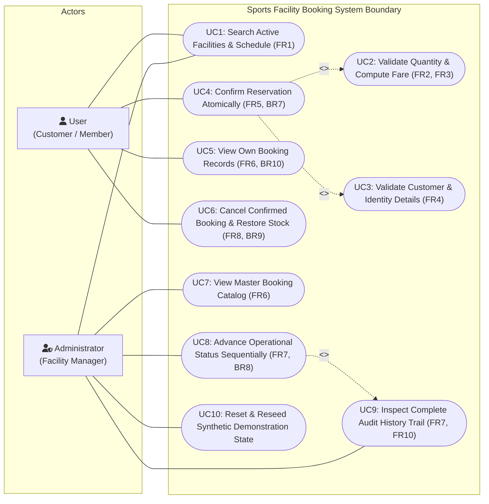
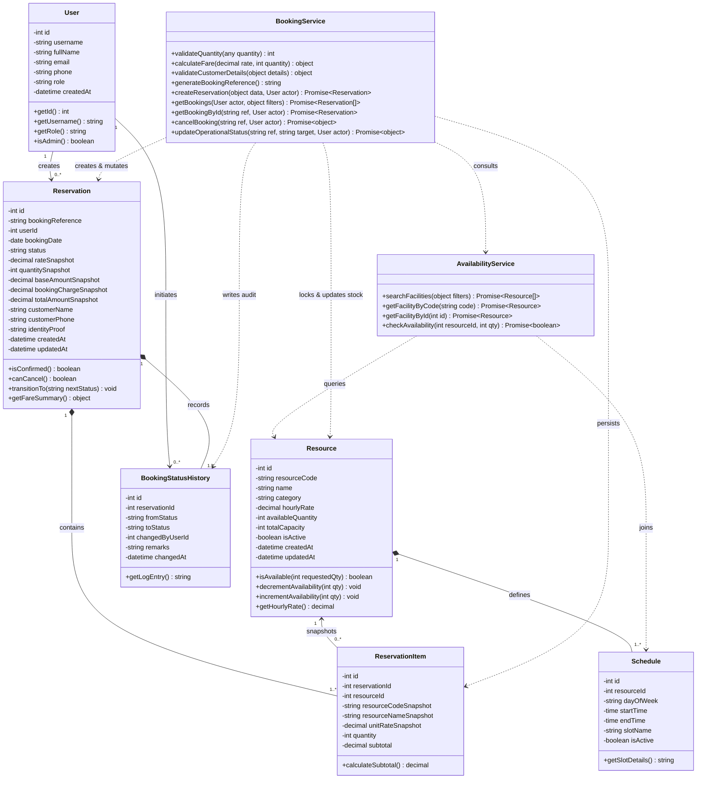

# UML Design Document
## Sports Facility Booking System

In strict accordance with the assessment specification, this document contains **exactly two UML diagrams**:
1. **Use Case Diagram** (Actor roles and all compulsory system actions)
2. **Class Diagram** (Core domain entities, services, attributes, operations, and multiplicities)

---

### 1. UML Use Case Diagram

The Use Case Diagram defines the interactions between the two system actors (**User** and **Administrator**) and the system boundary. It highlights the compulsory flows including facility search, boundary validation, atomic confirmation, ownership-scoped viewing, one-time stock-restoring cancellation, and stage-gated operational status progression.

#### Use Case Description & Actor Mappings:
1. **UC1 (Search Facilities)**: User and Administrator search and browse active facilities (R101–R105), operating schedules, hourly rates, and real-time available quantities.
2. **UC2 (Validate Quantity & Compute Fare)**: Rejects quantities outside 1–5; calculates base amount and applies the Rs.50 / Rs.0 booking charge threshold.
3. **UC3 (Validate Customer Details)**: Verifies non-blank name, 10-digit phone, future date, and identity proof.
4. **UC4 (Confirm Reservation Atomically)**: Re-validates availability under database lock, creates reservation, snapshot items, and status history atomically.
5. **UC5 (View Own Bookings)**: Scoped strictly to the authenticated user ID; unauthorized foreign bookings blocked.
6. **UC6 (Cancel Confirmed Booking)**: Cancels only CONFIRMED bookings; restores inventory exactly once; rejects repeated attempts.
7. **UC7 (View Master Catalog)**: Admin view of all reservations across all users.
8. **UC8 (Advance Operational Status)**: Admin-only transition: `CONFIRMED` → `CHECKED_IN` → `COMPLETED` (skipping stages prohibited).
9. **UC9 (Inspect Audit History)**: Comprehensive timestamped audit timeline inspection.
10. **UC10 (Reset Synthetic State)**: Reinitializes database to clean demonstration data.

---

### 2. UML Class Diagram

The Class Diagram illustrates the architectural structure of the system, including entity classes (`User`, `Resource`, `Schedule`, `Reservation`, `ReservationItem`, `BookingStatusHistory`), service classes (`AvailabilityService`, `BookingService`), their attributes, types, visibility, methods, relationships, and multiplicities.

---

### 3. Structural Design Details & Traceability

#### Key Design Patterns & Architectural Decisions:
1. **Service Layer Pattern**: 
   - `AvailabilityService` handles read-heavy queries, catalog filtering, and schedule joining.
   - `BookingService` encapsulates complex business rules (BR1–BR10), transaction orchestration, validation, and lifecycle guards.
2. **Snapshot Immutability (BR3)**: 
   - Financial attributes (`rateSnapshot`, `baseAmountSnapshot`, `bookingChargeSnapshot`, `totalAmountSnapshot`) and resource names (`resourceNameSnapshot`, `resourceCodeSnapshot`) are stored directly on `Reservation` and `ReservationItem`. They remain completely decoupled from subsequent changes in `Resource.hourlyRate`.
3. **Pessimistic Concurrency & ACID Integrity (BR2, BR6, BR7)**:
   - In `createReservation` and `cancelBooking`, rows are locked via `SELECT ... FOR UPDATE` within MySQL transactions, preventing double-allocation and ensuring atomic updates across `reservations`, `reservation_items`, `resources`, and `booking_status_history`.
4. **Finite State Machine (FSM) Lifecycle (BR8, BR9)**:
   - Permitted states: `CONFIRMED`, `CHECKED_IN`, `COMPLETED`, `CANCELLED`.
   - Valid operational transitions: `CONFIRMED` → `CHECKED_IN` → `COMPLETED`.
   - Valid cancellation transition: `CONFIRMED` → `CANCELLED` (with automatic one-time stock restore).
   - All invalid jumps (e.g. `CONFIRMED` → `COMPLETED`, or cancelling a `CANCELLED` booking) are rejected.
